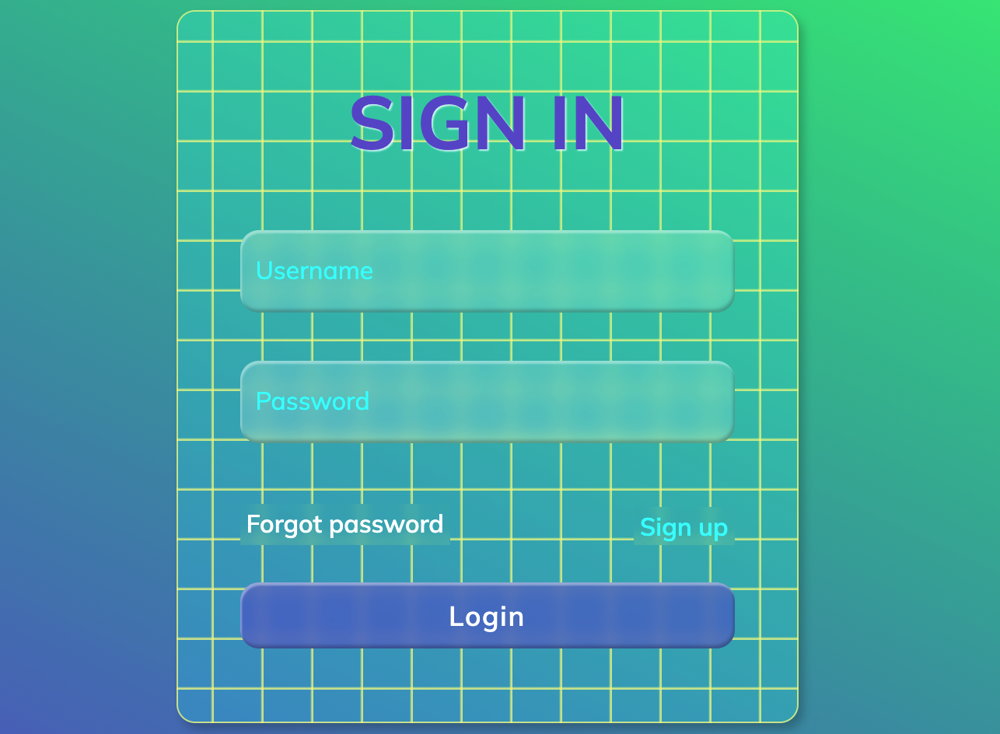

# Form Data


A web application to showcase form-handling and password-based access control. It serves a public webpage where users can enter a password, listens for POST requests, and logs them to the console. If the correct password is submitted, the user is granted access. Otherwise, they are redirected back to the home page.

The application works with a serving file that serves static files from the `public` folder and uses the third-party middleware `body-parser` to handle form data, custom middleware `accessCheck` to validate the password in a simplified access control logic (grant or deny).

## Visuals



## Installation and Usage

Remember that for the code to work, you need to have Node.js and npm installed on your machine.

Get the repository and install the dependencies

   ```bash
➡️ git clone https://github.com/tpreisig/form-data.git
➡️️ cd form-data
➡️ npm install
   ```

Dependencies and devDependencies

```bash
  "dependencies": {
    "body-parser": "^1.20.5",
    "express": "^4.22.2"},
  "devDependencies": {
    "nodemon": "^3.1.14"}
```

Run the serving file

```bash
➡️  npm run start 

  "scripts": {
    "start": "node server",
    "dev": "nodemon server"},
```

The application will be available at `http://localhost:3500`.\
The password for any user is 'Ramification'.  
Details can be found here: https://github.com/tpreisig/form-data/blob/main/index.js
or here:

```bash
function accessCheck(req, res, next) {
    if (req.body["password"] === "Ramification") {
        userIsAuthorised = true;
    } else {
        userIsAuthorised = false;
    }
    next();
}
```

## License

This project is licensed under the MIT License - see the [LICENSE](LICENSE) file for details.


## Contact

Maintained by tpreisig - feel free to reach out!